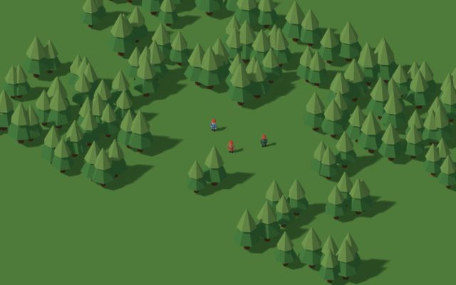
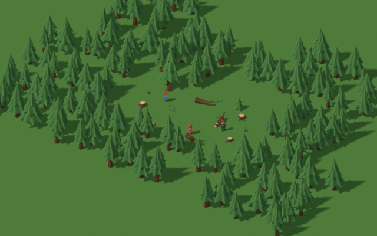
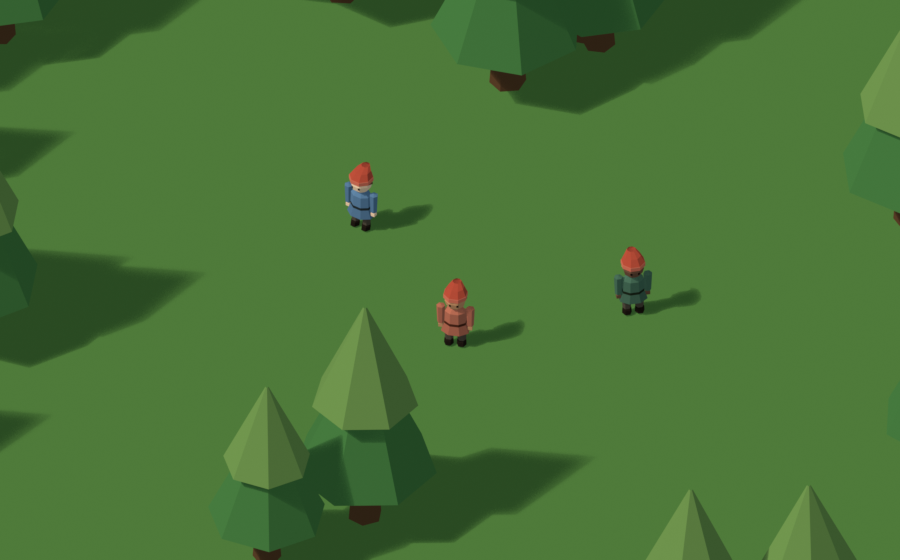
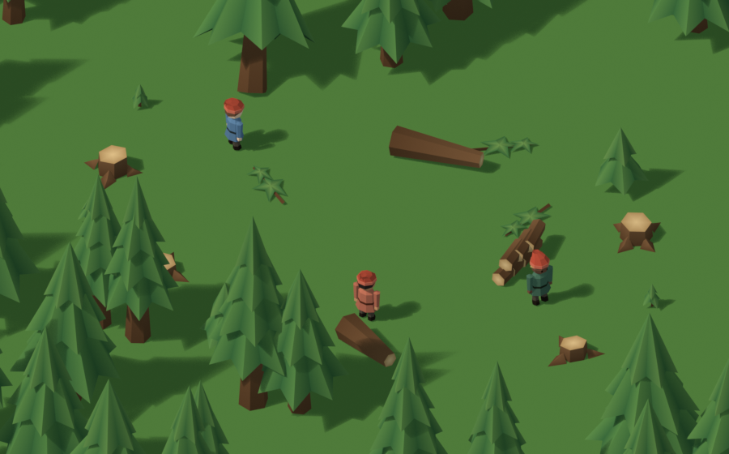
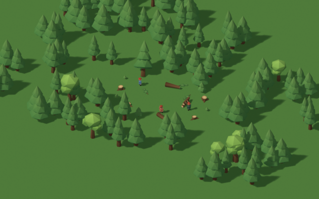
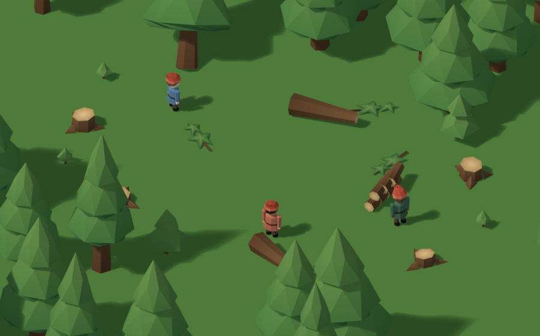

# Kit d'arbres pour l'exploitation : étude (27 octobre 2026)

Statut : **proposition B validée par Tristan le 27 octobre 2026** (étages arrondis et feuillu) ; fichier à intégrer : `kit-arbres-b.json`. La proposition A est conservée pour mémoire. Aucun code du jeu n'est modifié.

Le kit remplace le sapin actuel, fait d'un fût et de deux cônes générés dans `BabylonVillageScene.ts` (`#buildWoodland`), par des pièces modélisées pour le cycle de vie d'un bosquet exploité. Il garde le même style, la même échelle et les mêmes teintes.

## Pièces

| Pièce | Rôle | Triangles |
| --- | --- | ---: |
| `sapin-a-fut` + `sapin-a-feuillage` | adulte, 3 étages | 24 + 80 = 104 |
| `sapin-b-fut` + `sapin-b-feuillage` | adulte large, 3 étages | 24 + 84 = 108 |
| `sapin-c-fut` + `sapin-c-feuillage` | adulte élancé, 4 étages | 24 + 96 = 120 |
| `pousse-plant` | petit plant, 0,36 m | 20 |
| `pousse-arbuste` | arbuste, 0,96 m | 24 |
| `souche-a` | souche haute, 4 racines, coupe inclinée | 34 |
| `souche-b` | souche basse, 3 racines | 30 |
| `buche` | tronçon couché de 0,45 m, pour les tas et les chargements | 24 |
| `branche` | branche au sol, pour l'ébranchage | 26 |

Budgets demandés, tous tenus : adulte ≤ 150, souche ≤ 40, pousse ≤ 30. Le sapin actuel fait environ 60 triangles.

- **Échelle de l'arbre actuel** : base du fût de 0,38 m, feuillage dès 0,6 à 0,9 m, sommet de 2,75 à 3 m.
- **Origine au centre de la base, au sol** : c'est aussi le pivot de l'abattage.
- **Fût et feuillage séparés.** Le fût a une face de coupe en bois clair à chaque bout. On peut donc le raccourcir tronçon par tronçon (échelle en y) et le coucher sans laisser de trou visible. Sa hauteur, sous le feuillage, est donnée par `trunkTop` dans le JSON.
- **Étages en jupe étoilée** : pointes retombantes claires, creux sombres et dessous plus foncé, pour une silhouette lisible vue de dessus. Les étages hauts sont plus clairs.
- **Couleurs de sommet, sans texture** : écorce `#523620`, feuillage `#294e2d`, `#3f6c35` et `#668442` comme les matériaux actuels, bois de coupe `#d2ae78` et cerne `#a98352`.

## Aperçus

| | Actuel | Kit |
| --- | --- | --- |
| Zoom moyen (villageois de 17 px) |  |  |
| Zoom rapproché |  |  |

Planche des pièces : [previews/planche-pieces.png](previews/planche-pieces.png).

La scène du kit montre une clairière de coupe : souches, pousses aux deux stades, fûts couchés (dont un raccourci), tas de bûches, branches au sol et trois bûcherons pour l'échelle.

## Proposition B : étages arrondis et feuillu

Une seconde proposition de style, plus ronde, dans l'esprit des figurines. Elle a les mêmes pièces, la même échelle et le même pivot. Elle est générée par `ARBRES_STYLE=b` et exportée dans `kit-arbres-b.json`.

- **Sapins** : chaque étage est un volume plein, avec un bourrelet sombre en dessous, un rebord, une épaule claire et une pointe. Les facettes sont décalées d'un anneau à l'autre, sans pointes retombantes.
- **Feuillu** (`feuillu-a`) : trois touffes à facettes sur un fût, dans un vert plus jaune. En forêt, on en tire un pour quatre sapins, pour varier les silhouettes.
- **Pousses, souches et bûche** : arrondies de la même façon, avec des fûts à 7 pans et 3 racines.

| Pièce | Triangles |
| --- | ---: |
| `sapin-a`, `sapin-b`, `sapin-c` (fût + feuillage) | 129, 129, 126 |
| `feuillu-a` | 24 + 72 = 96 |
| `pousse-plant`, `pousse-arbuste` | 21, 26 |
| `souche-a`, `souche-b` | 33, 33 |
| `buche`, `branche` | 28, 26 |

| Zoom moyen | Zoom rapproché |
| --- | --- |
|  |  |

Planche des pièces : [previews/planche-pieces-b.png](previews/planche-pieces-b.png).

Les budgets sont tenus, mais les sapins B coûtent environ 20 % de triangles de plus que les A.

## Pour l'intégration

1. **Format** : `kit-arbres.json` reprend celui du kit des villageois. Les triangles ne sont pas indexés, les positions sont des entiers × 10⁻⁴ m, les couleurs sont × 1/200 et données par sommet (`colorsPerVertex`). Les axes du jeu sont x, y vers le haut, z.
2. **Instances** : un maillage source par pièce et des *thin instances* par bosquet, comme aujourd'hui. Il faut un seul matériau à couleurs de sommet au lieu du `MultiMaterial` actuel. Le choix de la variante peut venir du même hash que la rotation.
3. **Arbre couché** : c'est l'adulte, basculé de 90° sur son pivot. Une fois au sol, il faut le remonter du rayon du fût (0,19 m × échelle) si le feuillage a été retiré. Avec le feuillage, l'étage bas traverse le sol : retirer le feuillage dès le premier tronçon coupé, comme prévu, évite ce cas.
4. **Repousse** : aujourd'hui, `woodlandTrees` réduit l'échelle des arbres avec le stock, jusqu'à 0,2. Le kit permettrait plutôt de montrer des souches et des pousses quand le stock est bas, puis des adultes qui grandissent. C'est un choix de rendu, **à trancher par Tristan** : le kit ne l'impose pas.
5. **Exclusions** : la largeur du fût ne change pas. `woodlandPassage` (0,19 m × échelle) reste donc juste pour les adultes ; une souche peut garder la même emprise.

## Fichiers

- `sources/kit_arbres.py` : génère les pièces, les scènes de démonstration, les rendus, `arbres.blend` et `kit-arbres.json` ; avec `ARBRES_STYLE=b`, `arbres-b.blend` et `kit-arbres-b.json`. À lancer sans interface :
  `blender --background --factory-startup --python blender-elements/arbres/sources/kit_arbres.py`
- `arbres.blend` : scènes `ARBRES actuel`, `ARBRES kit` et `ARBRES planche` ; `arbres-b.blend` : `ARBRES kit-b` et `ARBRES planche`.
- `previews/` : rendus EEVEE sous la caméra du jeu.
