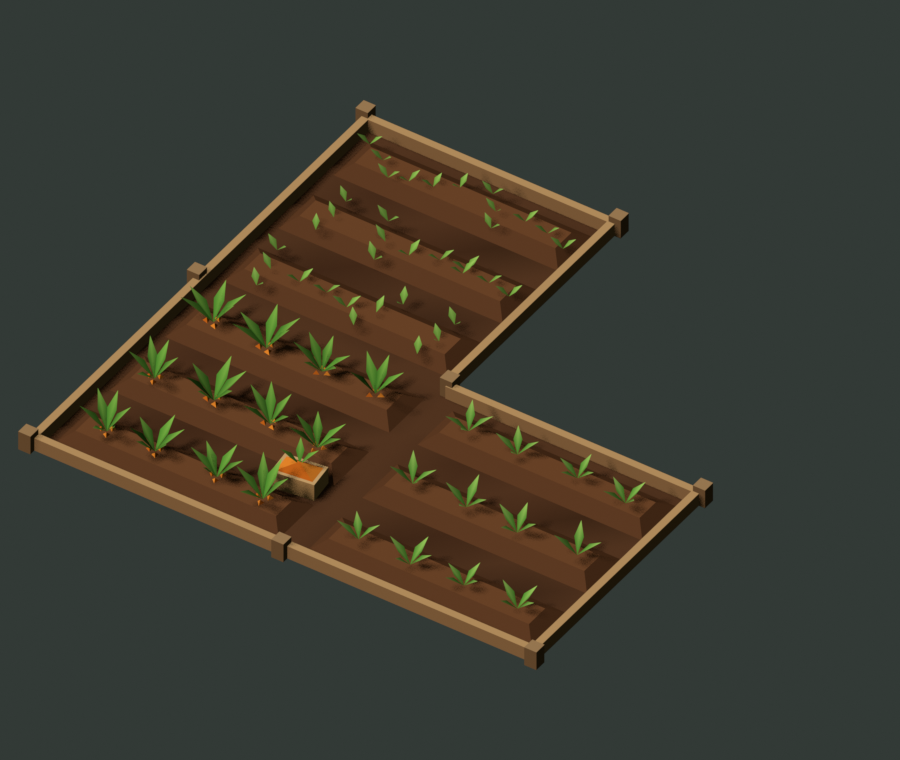

# Kit jardins « carré potager » — v1 (25 octobre 2026)

Kit retenu par Tristan pour remplacer les jardins de carottes. Conception, comparaison avec le V8 d'Astra et arbitrages : [`../contre-proposition-opus/README.md`](../contre-proposition-opus/README.md). Aucun code du jeu n'est modifié par ce kit.

*`assets/exemple-L.glb` réimporté dans Blender et éclairé par un soleil, aux stades 7 / 4 / 2.*

## Contenu

| Fichier | Rôle |
| --- | --- |
| `assets/carre-potager.glb` | Les 17 pièces, toutes à l'origine avec une transformation identité (96 Ko, atlas inclus). |
| `assets/exemple-L.glb` | Le L de référence (cellules (0,0), (1,0), (0,1), stades 7 / 4 / 2), un seul maillage, pour contrôler le chargeur. |
| `textures/atlas-lointain.png` | Atlas 512 × 256 des plaques lointaines (déjà incorporé au GLB). |
| `textures/stades-240/` | Vues du dessus 240 × 240 non réduites, pour retoucher l'atlas. |
| `manifest.json` | Pièces, origines, triangles, règles de pose, cases d'atlas, budgets. |
| `validation.json` | Résultat du réimport des GLB. |

## Pièces

| Pièce | Triangles | Origine (coordonnées Blender, Z haut) |
| --- | ---: | --- |
| `SOCLE` | 62 | Coin bas gauche de la cellule ; sol + trois buttes fusionnés. |
| `SOL` | 32 | Coin bas gauche ; sol nu (chantier, cellule réservée). |
| `BUTTE` | 10 | Centre de la butte ; grand axe X. Fournie seule pour d'autres poses ; `SOCLE` la contient déjà. |
| `BORDURE` | 10 | Longe X de 0 à 2,5 m ; face extérieure à Y=0, intérieur vers +Y. |
| `POTEAU` | 10 | Centré sur le coin, pied à Z=0. |
| `SEMIS` | 12 | Pied au centre. |
| `TOUFFE_JEUNE` | 8 | Pied au centre. |
| `TOUFFE_MURE` | 21 | Pied au centre. |
| `CAGETTE` | 22 | Centre de la caisse, fond à Z=0. |
| `LOINTAIN_STADE_1..7`, `LOINTAIN_SOL` | 2 | Coin bas gauche ; carré 2,5 × 2,5 m, UV sur l'atlas. |

Deux matériaux **éclairés, simple face, sans métal ni reflet** :
- `OPUS_terroir` : la couleur vient de `COLOR_0`, sans texture. Les couleurs ne contiennent aucun ombrage : c'est la lumière du jeu qui donne le relief, y compris la nuit.
- `OPUS_lointain` : la couleur vient de l'atlas.

Il n'y a pas d'extension `KHR_materials_unlit`.

**Axes** : glTF a Y en haut. La conversion Blender (x, y, z) → glTF (x, z, −y) est faite par l'exporteur. Le manifeste reste en coordonnées Blender. Il ne faut pas ajouter de seconde inversion dans Babylon.

## Assemblage d'une cellule (proche)

1. **`SOCLE`** au coin de la cellule.
2. **Douze touffes** aux positions X ∈ {0,45 ; 0,98 ; 1,52 ; 2,05} × Y ∈ {0,43 ; 1,25 ; 2,07}, à Z = 0,09 (sommet des buttes).
   - Chaque emplacement reçoit une variation fixe : décalage ±0,04 (X) et ±0,03 (Y), rotation Z quelconque, échelle 0,9 à 1,1.
   - Cette variation doit rester la même d'un stade à l'autre. Il faut la tirer d'une graine stable, par exemple l'identifiant de cellule et l'indice d'emplacement.
3. **Croissance uniforme** : les 12 touffes prennent ensemble la pièce et l'échelle du stade, qui se multiplie à la variation de l'emplacement.

   | Stade | 1 | 2 | 3 | 4 | 5 | 6 | 7 |
   | --- | --- | --- | --- | --- | --- | --- | --- |
   | Pièce | `SEMIS` | `SEMIS` | `TOUFFE_JEUNE` | `TOUFFE_JEUNE` | `TOUFFE_MURE` | `TOUFFE_MURE` | `TOUFFE_MURE` |
   | Échelle | 1,0 | 1,45 | 0,8 | 1,05 | 0,78 | 0,9 | 1,0 |

4. **`CAGETTE`** au stade 7, en (2,12 ; 0,84 ; 0), rotation Z de 0,12 rad.
5. **Clôture du jardin** :
   - `BORDURE` uniquement sur les côtés dont la cellule voisine n'appartient pas au même jardin. Rotations 0°, 90°, 180° et −90° autour du coin de départ du côté, dans l'ordre sud, est, nord, ouest.
   - `POTEAU` à chaque extrémité de côté exposé, dédupliqué par position canonique, en tenant compte de la topologie torique d'Arbestra.

Budgets d'une parcelle isolée :
- **416 triangles** pleine, 286 au stade 1 ;
- **1 168** pour le L plein ;
- **2 triangles** par cellule au loin.

## Niveau lointain

On remplace la cellule entière (socle, touffes, cagette) par `LOINTAIN_STADE_k`, ou `LOINTAIN_SOL` pour une cellule nue. Bordures et poteaux sont absents des vignettes et disparaissent au loin ; c'est voulu, pour ne pas dessiner de fausses clôtures entre les cellules d'un même jardin.

**L'atlas** :
- 4 colonnes × 2 lignes de cases de 128 px : 120 px de contenu et 4 px de débord répété de chaque côté ;
- ordre depuis le coin haut gauche : stades 1, 2, 3, 4, puis 5, 6, 7, sol ;
- les UV sont déjà exportées ; il ne faut pas retourner l'image.

Le débord protège des premiers niveaux de mipmap, pas des derniers. Il faut donc vérifier les coutures à la distance réelle.

Deux niveaux suffisent : le modèle proche coûte déjà moins que le LOD1 du V8. Le seuil de bascule et son hystérésis restent à régler à la caméra du jeu ; ils ne sont pas dans les GLB.

## Recommandations moteur

- **Décor statique** : fusionner `SOCLE`, les bordures et les poteaux en un maillage par jardin.
- **Touffes et cagettes** : `SEMIS`, `TOUFFE_JEUNE`, `TOUFFE_MURE` et `CAGETTE` en *thin instances* pour tout le village, soit quatre appels de dessin. Un changement de stade ne réécrit que des matrices.
- **Plaques lointaines** : une *thin instance* de plaque par stade, ou un seul maillage avec un décalage d'UV par instance.
- **Matériaux** : partager les deux matériaux, et ne pas activer le double face.

## Reste à faire hors du kit

- **Le convertisseur `.abmesh.gz`** (`scripts/convert-garden-kit.mjs`, non commité, écrit pour le V8) est à adapter à ces noms de pièces.
- **Rien n'est mesuré dans Babylon**, ni sur MX230 ou Catmark.
- **La séparation entre croissance et stock récoltable** est une question de jeu (voir la note de conception). Le kit fournit déjà deux signaux distincts : la taille des touffes et la cagette.

## Régénérer

Dans Blender, exécuter dans un même espace de noms :
1. `../contre-proposition-opus/sources/build_opus.py` ;
2. `../contre-proposition-opus/sources/export_kit.py`, avec la variable `SOURCE` définie sur son propre chemin.

Le second script rend les vignettes, assemble l'atlas, exporte les deux GLB, écrit le manifeste, puis réimporte les GLB pour remplir `validation.json`. Il crée et supprime des scènes temporaires `OPUS …`. Il lit seulement la caméra de la scène `V8 L_LOD0` pour l'aperçu.
