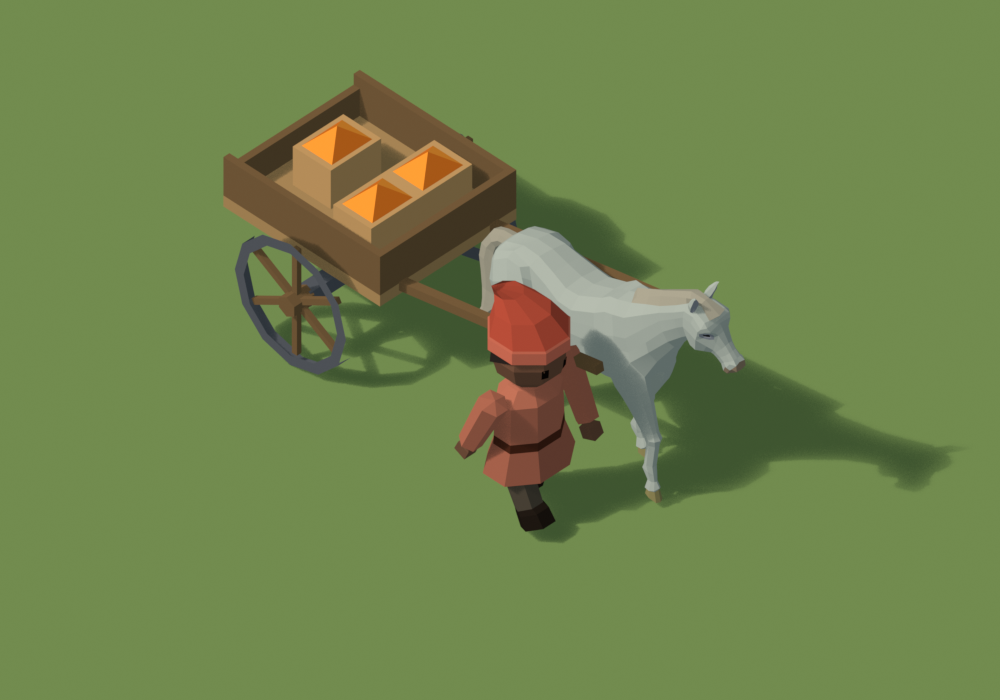
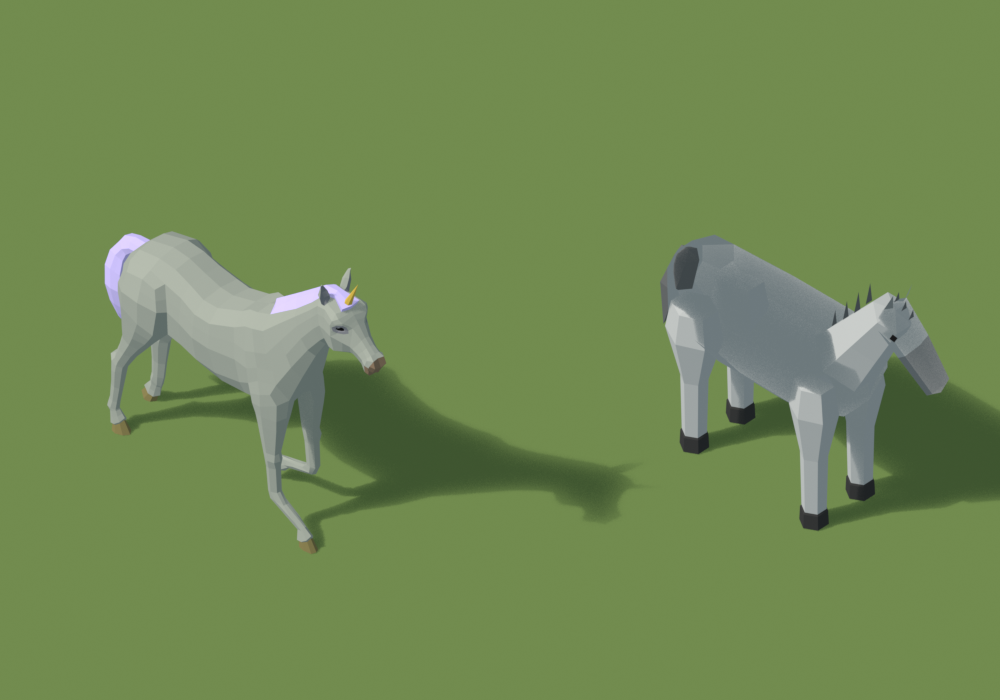

# Cheval de Quaternius : essai d'intégration (25 octobre 2026)

Mon cheval procédural (`../villageois/sources/attelage.py`) ne convainquait pas. Ce dossier essaie à la place un cheval low poly animé par un artiste, avec ses vraies allures.

## Le modèle

- **White Horse**, de **Quaternius**, publié sur [Poly Pizza](https://poly.pizza/m/bEdE4rmZy9). Licence **CC0** (domaine public) : utilisable librement, y compris en commercial ; le crédit n'est pas obligatoire mais il est donné ici.
- Fichier d'origine : `source/quaternius-white-horse.glb`, 1,1 Mo, téléchargé depuis `static.poly.pizza` le 25 octobre 2026.
- **Contenu** :
  - un seul maillage de 2 182 triangles et 7 matériaux unis, sans texture ;
  - un squelette : dos, 3 vertèbres de cou, tête, oreilles, épaules, jambes avec cinématique inverse, 7 vertèbres de queue.
- **Animations** :
  - allures : `Walk` (28 images), `Gallop` (14), `Gallop_Jump` ;
  - attentes : `Idle`, `Idle_2`, `Idle_Headlow` (tête basse), `Eating` (broute) ;
  - réactions : `Idle_HitReact_Left` et `_Right`, `Jump_toIdle`, `Attack_Kick`, `Attack_Headbutt`, `Death`.

  Il n'y a **pas de trot**. Pour les attelages, qui vont au pas, ce n'est pas gênant.

## Mise à l'échelle et réglages

- **Échelle** : le modèle mesure 5,7 × 4,8 unités, et son armature porte une échelle interne de 100 (modèle fait en centimètres). Réduit d'un facteur 0,1785, il fait environ 1 m de long et 0,85 m aux oreilles : le même gabarit que l'étude des routes.
- **Matériaux** : rendus mats (rugosité 1, aucun reflet) pour s'accorder aux figurines.
- **Foulée** : mesurée sur le squelette. Le pas avance à environ **0,17 m/s** à cette échelle, une vitesse qui évite le glissement des sabots ; elle est à affiner à l'œil.
- **Attelage** : la carriole s'accroche au poitrail, au milieu des deux épaules, à 0,40 m de haut et 0,24 m devant le centre. L'essieu est à 1,04 m derrière.
- **Licorne** : la même bête, avec la crinière en lavande (copie du matériau « Hair ») et une corne dorée rattachée à l'os de la tête, qui suit donc ses mouvements.

## Aperçus

*À gauche, la licorne Quaternius. À droite, mon cheval procédural.*

- Images : `previews/pas.png`, `previews/galop.png`, `previews/tete-basse.png` ; `previews/ensemble-17px.png` montre les silhouettes à 17 px.
- Vidéo : `previews/attelage-quaternius-au-pas.mp4`, l'attelage au pas pendant 4 s.

## Ce que ça implique pour le jeu

- **Animation par squelette** : contrairement aux figurines (pièces rigides en *thin instances*), ce cheval est un maillage déformé par un squelette. Dans Babylon, deux voies :
  - l'animation de squelette classique, coûteuse par cheval affiché ;
  - des animations précalculées dans une texture, partagées par toutes les instances. C'est la solution prévue pour les foules et elle reste compatible avec les *thin instances*. À mesurer.
- **Harnais et carriole** : il faudra ajouter au modèle un collier attaché aux os du cou et des épaules. Les brancards s'accrochent au poitrail.
- **Le modèle n'est pas encore converti** au format du jeu (`.abmesh.gz`). La chaîne actuelle convertit des maillages statiques, pas des squelettes animés.

## Fichiers

- `source/quaternius-white-horse.glb` : le modèle d'origine, non modifié.
- `cheval-quaternius.blend` : scène `VIL cheval Quaternius` avec l'alignement des animations, l'attelage animé, la licorne et mon cheval pour comparaison.
