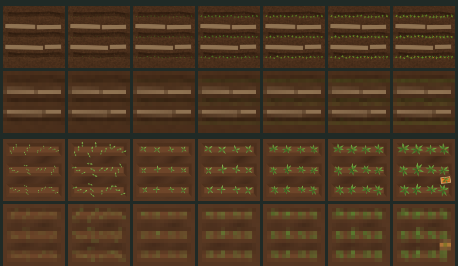
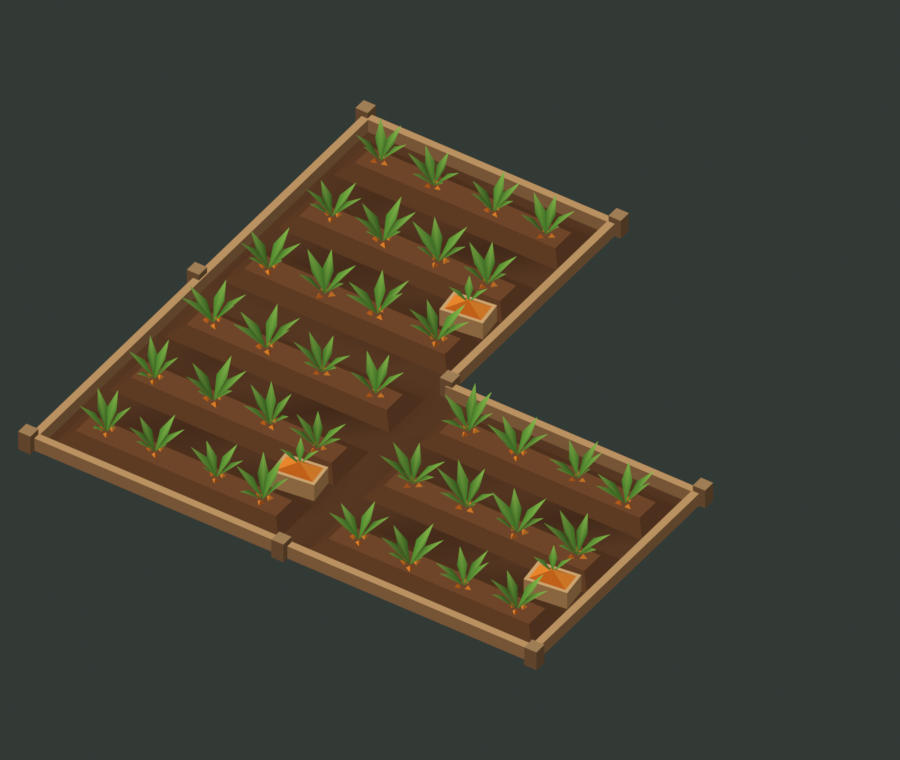
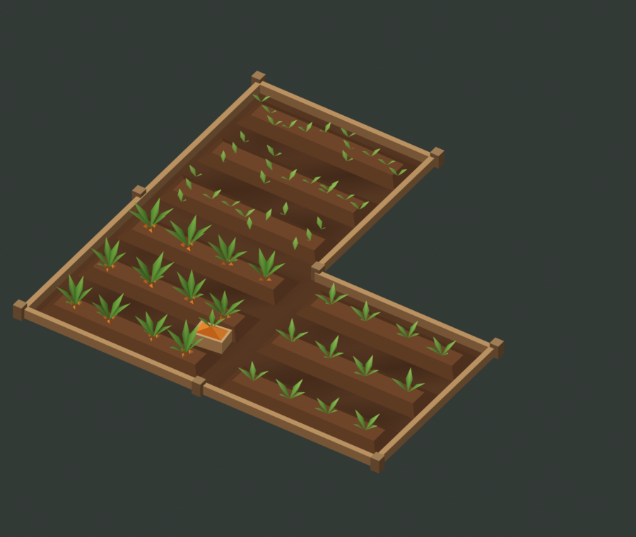

# Contre-proposition jardins : le « carré potager » (Opus 5.5, 25 octobre 2026)

Réponse au kit V8 d'Astra (`../v8/`). Tristan a retenu la direction le 25 octobre, avec une **croissance uniforme à l'affichage**. Ce n'est pas encore un asset d'intégration (voir « Reste à faire »). Aucun code du jeu n'est modifié.

## Les contraintes

- **La caméra** ne descend pas sous 8 m de rayon et joue surtout bien plus haut. Une parcelle de 2,5 m n'y occupe que quelques dizaines de pixels.
- **Le goulot actuel des gros villages est le GPU** (`SESSION-HANDOFF.md`, rendu des gros villages : images de 0,4 à 1,4 s sur Catmark).

*Lignes, de haut en bas : V8 proche, V8 réduit à 16 px, carré potager proche, carré potager réduit à 16 px. Colonnes : stades 1 à 7. Vues du dessus sans clôture, comme les bakes V8.* À 16 px, les stades V8 se confondent et les planches claires dominent. Dans le carré potager, la surface verte croît de stade en stade ; les stades 1 à 3 restent proches.

## Le modèle

Une parcelle est un **carré potager à bordure de bois**. Les trois buttes sont conservées sur les mêmes axes que le V8 et portent **12 touffes** (4 par butte) au lieu de 48 plants.

- **Croissance uniforme** : les 12 touffes passent ensemble par trois pièces et une échelle. Chaque emplacement garde sa rotation et sa variation d'échelle d'un stade à l'autre.

  | Stade | 1 | 2 | 3 | 4 | 5 | 6 | 7 |
  | --- | --- | --- | --- | --- | --- | --- | --- |
  | Pièce | semis | semis | jeune | jeune | mûre | mûre | mûre + cagette |
  | Échelle | 1,0 | 1,45 | 0,8 | 1,05 | 0,78 | 0,9 | 1,0 |

- **Plein = une cagette de carottes** dans l'allée, au lieu de la carotte géante flottante (176 triangles en LOD0). Si un repère visible de très loin est nécessaire, il relève du HUD.
- **Bordure basse au lieu de piquets et cordes** : une planche de 10 triangles par côté exposé et des poteaux d'angle dédupliqués. La règle de fusion d'Astra est conservée : un côté n'a de bordure que si le voisin n'est pas dans le même jardin, et les coins sont dédupliqués par position canonique.
- **Aucune texture** : un seul matériau à couleurs de sommets, chargeable éclairé dans Babylon (question de la nuit soulevée à la relecture du V8).

 

*À gauche, le L plein, sous la caméra d'Astra. À droite, le même L avec trois stades différents : 7 en bas à gauche, 4 à droite, 2 en haut.*

## Budgets (mesurés sur les maillages Blender)

| | Carré potager | V8 LOD0 | V8 LOD1 |
| --- | ---: | ---: | ---: |
| Parcelle isolée pleine | **416** | 2 198 | 578 |
| Parcelle isolée, stade 1 | 286 | — | — |
| Jardin en L plein | **1 168** | 6 146 | 1 574 |
| 460 parcelles pleines isolées | ~191 000 | 1 011 080 | 265 880 |
| Matériaux / textures | 1 / 0 | 4 / 2 | 4 / 2 |

Pièces : sol en grille 4 × 4 (32 triangles), butte 10, bordure 10, poteau 10, semis 12, touffe jeune 8, touffe mûre 21, cagette 22.

La version proche coûte déjà moins que le LOD1 du V8. Deux niveaux suffisent donc : ce modèle, puis la plaque lointaine à 2 triangles et atlas, reprise du V8, avec des vignettes rendues depuis ce modèle.

**Appels de dessin visés** : le décor statique (sol, buttes, bordures, poteaux) est fusionné en un seul maillage par jardin. Semis, touffes jeunes, touffes mûres et cagettes sont quatre maillages en *thin instances* pour tout le village. Un changement de stade ne touche que des matrices d'instances.

## Ce que l'on perd

- La récolte se fait par touffe (12 par parcelle) et non plus plant par plant. Chaque touffe reste une instance indépendante.
- Il y a moins de matière de près : pas de veinage du bois, pas de chaînette de corde.
- La cagette au sol se voit moins de très loin qu'un marqueur flottant. Elle reste orange vif dans l'atlas lointain.

## Question de jeu ouverte (hors asset)

Tristan relève un non-sens : le jeu confond la croissance et le nombre de carottes prêtes à récolter. Aujourd'hui, `gardenTileStage` (`apps/world-web/src/scene/tile-appearance.ts`) dérive le stade du ratio `stock / capacité`. L'affichage en croissance uniforme suppose une vraie progression de culture, distincte du stock récoltable. Le modèle ne tranche pas cette question. Il expose deux signaux indépendants : la taille des touffes pour la croissance, et la cagette (ou son contenu) pour le récoltable.

## Kit produit

Le kit, l'atlas lointain et le manifeste sont livrés dans [`../carre-potager/`](../carre-potager/README.md) (export par `sources/export_kit.py`). Il reste à les charger dans Babylon et à mesurer sur MX230 et Catmark.

## Fichiers

- `sources/build_opus.py` : générateur. Exécuté dans Blender, il crée les scènes `OPUS kit`, `OPUS L plein`, `OPUS L croissance` et `OPUS sept stades` sans toucher aux scènes existantes. `build()` renvoie les comptes de triangles.
- `sources/garden-opus.blend` : ces quatre scènes seules.
- `previews/` : rendus EEVEE unlit sous la caméra orthographique du V8 (`L_*`), vue du dessus des sept stades et planche comparative.
