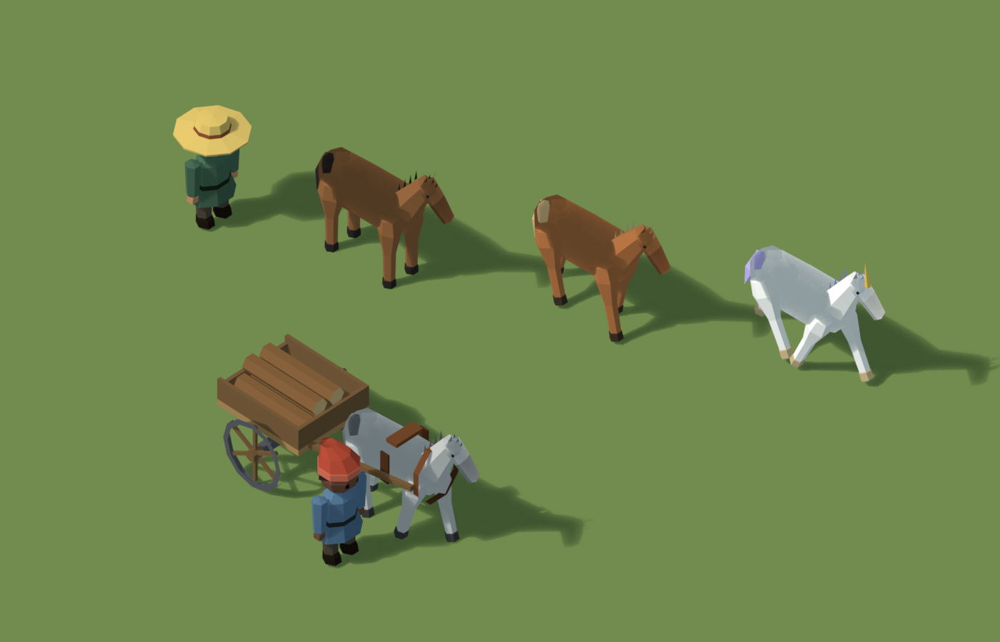
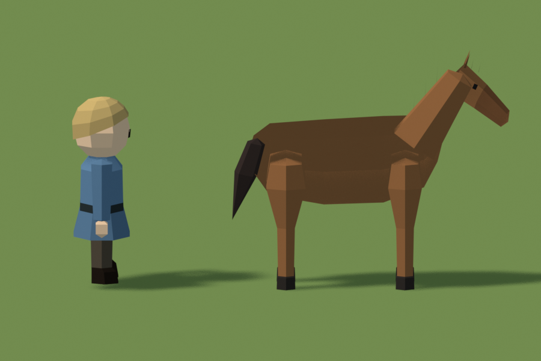
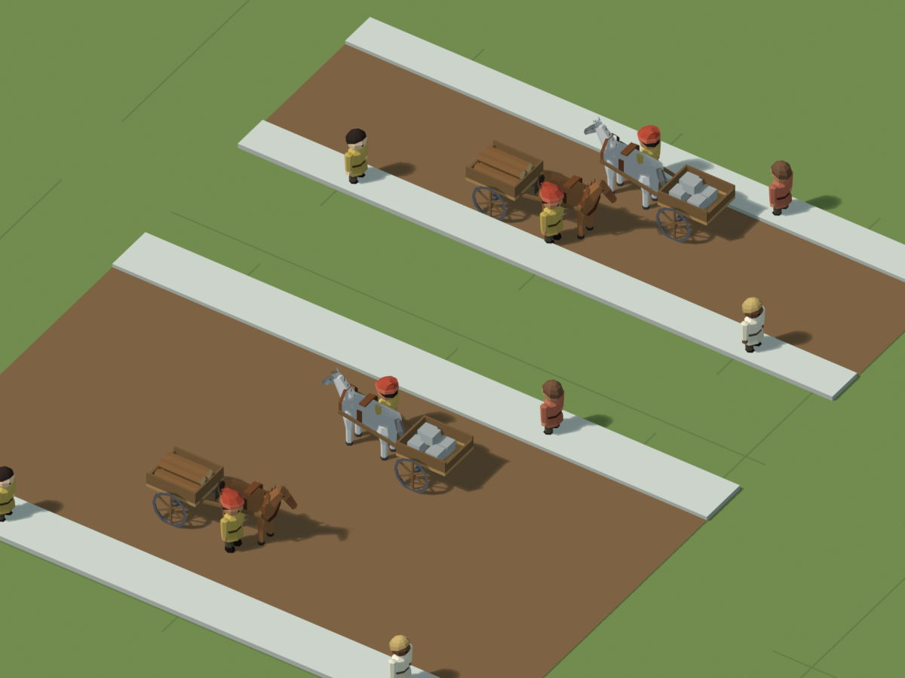
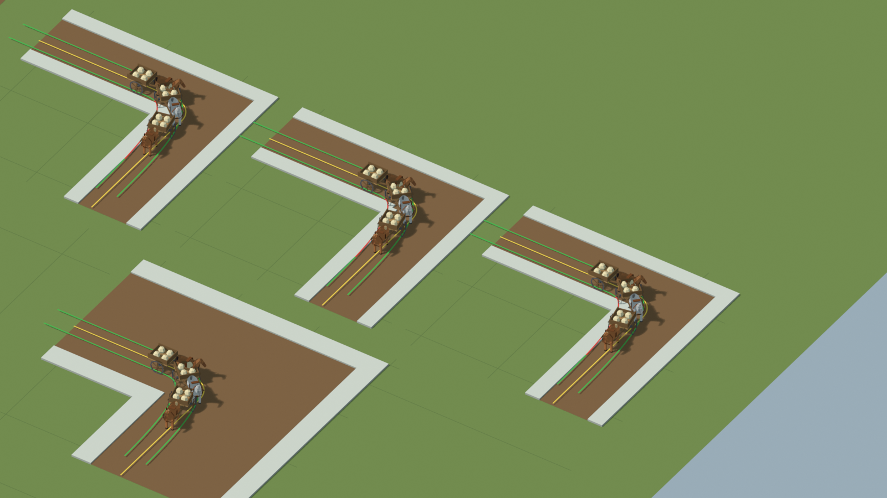
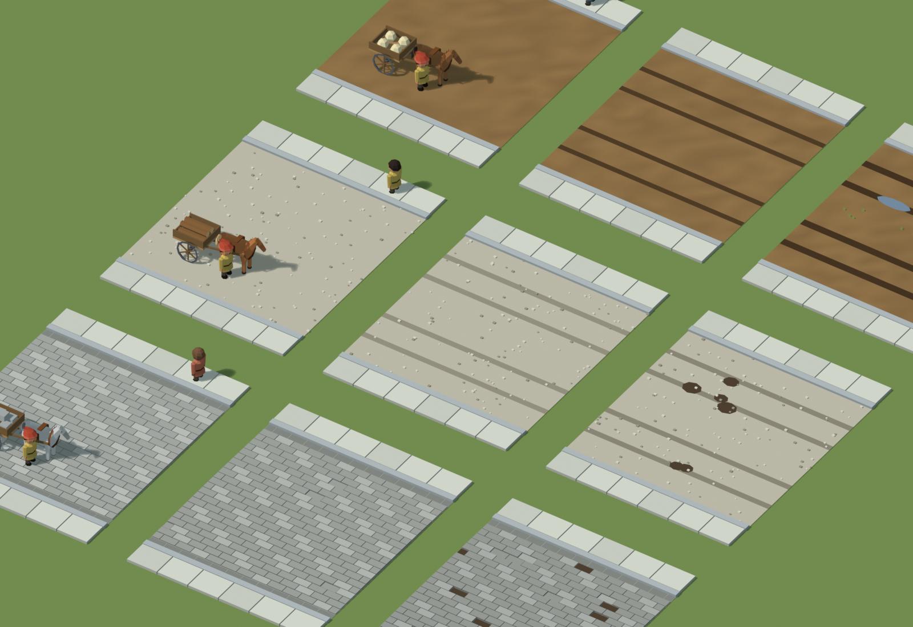
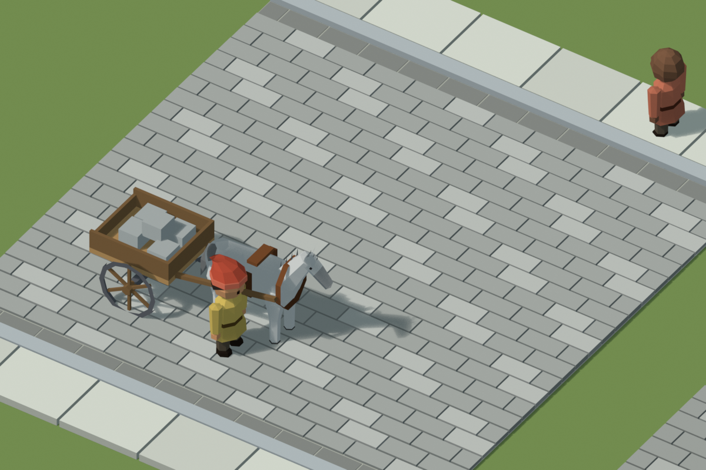
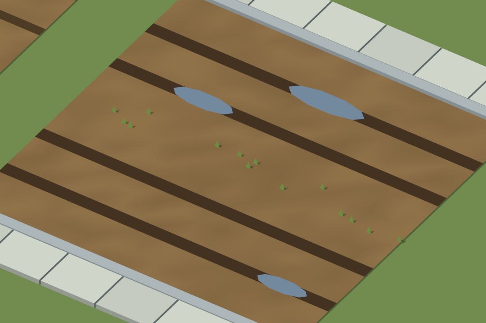
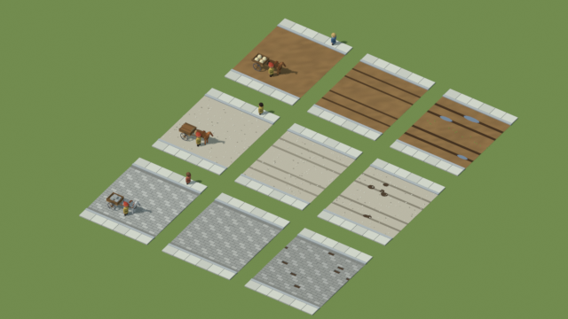

# Attelage, gabarit et revêtements de route (Opus 5.5, 25 octobre 2026)

Étude dans Blender, à l'échelle exacte du jeu : tuile de 2,5 m, revêtements rastérisés sur la grille du moteur de routes (1/16 de tuile, soit 0,156 m), villageois de 0,69 m. Rien n'est intégré au jeu. Aucune règle économique n'est créée : la possession des attelages, leur capacité, l'usure et les réparations restent à décider côté serveur.

## Cheval, licorne et carriole

- **Un squelette commun au cheval et à la licorne**. Pivots : quatre jambes, cou (incliné de 0,6 vers l'avant), tête, queue.
  - Allures procédurales : pas (quatre temps) et trot (bipèdes diagonaux), avec rebond du corps et balancement de l'encolure.
  - Robes : bai, alezan, gris. La licorne est une robe à crinière lavande, avec sabots dorés et corne.
- **Gabarit** : garrot à environ 0,6 m, soit le rapport d'un vrai cheval à un adulte.
- **Carriole à deux roues et brancards**, avec harnais (collier et sellette).
  - Roues de 0,22 m de rayon, entraxe de 0,62 m, largeur hors tout d'environ 0,72 m.
  - Charges : bois, pierre, sacs, cagettes de carottes.
- **Attelage complet** : environ 1,8 m de long. L'essieu est à 1,04 m du collier.
- **Cinématique de remorque** : le cheval suit le tracé, et l'essieu est tiré au bout des brancards. C'est elle qui donne la trace des roues dans les virages.

## Gabarit : largeur des routes commerciales

Circulation à droite, au pas. Deux attelages se croisent, avec des passants sur les trottoirs.

| Route | Trottoirs | Chaussée | Entre les deux carrioles | Carriole – trottoir |
|---|---:|---:|---:|---:|
| 1 tuile | 2 × 0,47 m (3 px) | 1,56 m | **0,05 m** | 0,02 m |
| 2 tuiles | 2 × 0,625 m (4 px) | 3,75 m | **1,15 m** | 0,57 m |

**Virage à 90° en tournant à droite** (le cas serré), avec un rayon de braquage du cheval de 0,7 m. Les traces des roues sont vertes sur la chaussée et rouges en dehors.

| Virage | Débord maximal de la roue intérieure hors chaussée | Hors des tuiles de la route |
|---|---:|---:|
| 1 tuile, angle vif | 0,38 m (sur le trottoir) | 0 |
| 1 tuile, pan coupé de 0,47 m | 0,30 m | 0 |
| 1 tuile, congé en arc de 0,47 m | 0,36 m | 0 |
| 2 tuiles, angle vif | **0** | 0 |

**Conclusions**
- **Une route d'une tuile ne convient pas à un trafic de carrioles à double sens.** Le croisement est à 5 cm, et la roue intérieure monte sur le trottoir à chaque virage. Le pan coupé et l'arc ne peuvent grignoter que le trottoir, puisque la case en diagonale peut porter un bâtiment ; ils ne suffisent donc pas. Une tuile reste bonne pour les piétons, ou pour une carriole à la fois (sens unique, ou croisement à des emplacements dédiés).
- **Une route de deux tuiles convient** : croisement confortable, et virage à angle vif sans quitter la chaussée. Pan coupé et arc y deviennent un choix esthétique, sans nécessité de gabarit.
- **Le réseau peut rester en segments axiaux.**

Ces chiffres dépendent du rayon de braquage supposé (0,7 m) et de l'entraxe des roues. Ils sont recalculés par `gabarit_routes.py` si ces valeurs changent.

## Revêtements et usure

Tronçons de deux tuiles : trottoirs de 0,625 m en dalles, avec une bordure de granit de 0,12 m côté chaussée. Colonnes : neuf, usé, dégradé.

| Revêtement | Neuf | Usé | Dégradé |
|---|---|---|---|
| **Terre battue** | sol uni | ornières sombres dans la trace des roues | ornières élargies, flaques, herbe au centre |
| **Empierrement** | gravier clair, cailloux épars | traces tassées plus sombres | nids-de-poule dans les traces |
| **Pavés** | pavés de 0,31 × 0,156 m (2 × 1 px) en quinconce, chaussée bombée de 2,5 cm, caniveaux sombres le long des bordures | quelques pavés enfoncés dans les traces | pavés manquants (boue), plus d'enfoncements |

 

**À 17 px** (zoom moyen), l'usure reste lisible : ornières, flaques, nids-de-poule, pavés manquants.

**Pistes pour l'usure** (à décider côté serveur) :
- L'usure se concentre dans la trace des roues. Un affichage par paliers (neuf, usé, dégradé) suffit visuellement, ce qui donne trois états par revêtement.
- La résistance croît de la terre à l'empierrement puis aux pavés : ton idée d'une pierre qui résiste mieux aux passages répétés de carrioles se traduit directement en vitesse de passage d'un palier à l'autre.
- Les pavés restent sur la grille actuelle : un pavé fait 2 × 1 pixels du moteur.

## Écarts relevés avec l'existant

- **Les routes automatiques font aujourd'hui 1,25 m de large, en terre, sans trottoir.** Les trottoirs du jeu font 0,625 m, comme ceux proposés ici pour la route de deux tuiles.
- **Les voies de circulation des villageois** (0,8 et 0,94 m, dans `BabylonVillageScene.ts`) datent de l'ancien profil. Elles ne correspondent plus à la route affichée.
- **Hauteur des trottoirs** : l'atelier de prévisualisation indique 0,04 m, alors que le code utilise 0,06 m.

## Fichiers

- `attelage-routes.blend` : scènes `VIL attelage`, `VIL gabarit routes` et `VIL revetements`.
- Sources, dans `../villageois/sources/` (même espace de noms que les figurines) :
  - `attelage.py` : cheval, licorne, carriole, allures, cinématique de remorque ;
  - `gabarit_routes.py` : banc d'essai des largeurs et des virages, mesures de débord ;
  - `revetements.py` : les trois revêtements en trois états d'usure.
