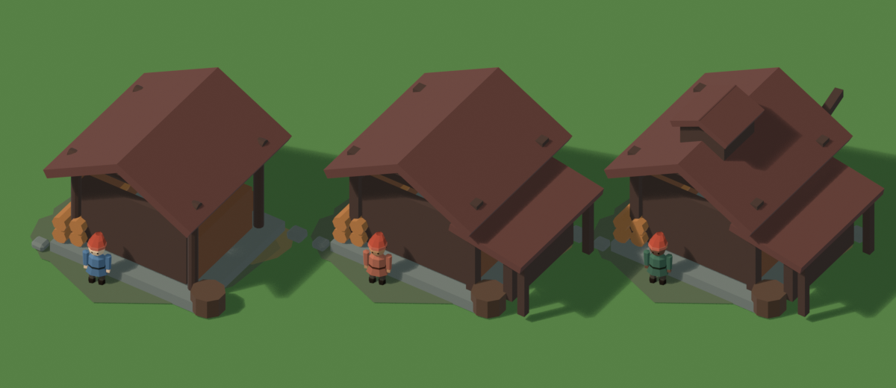
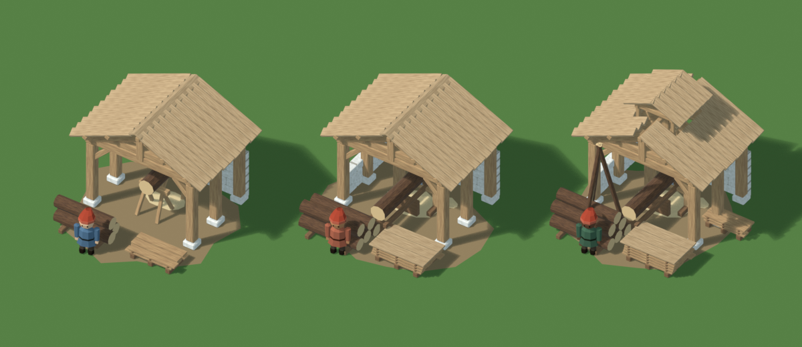
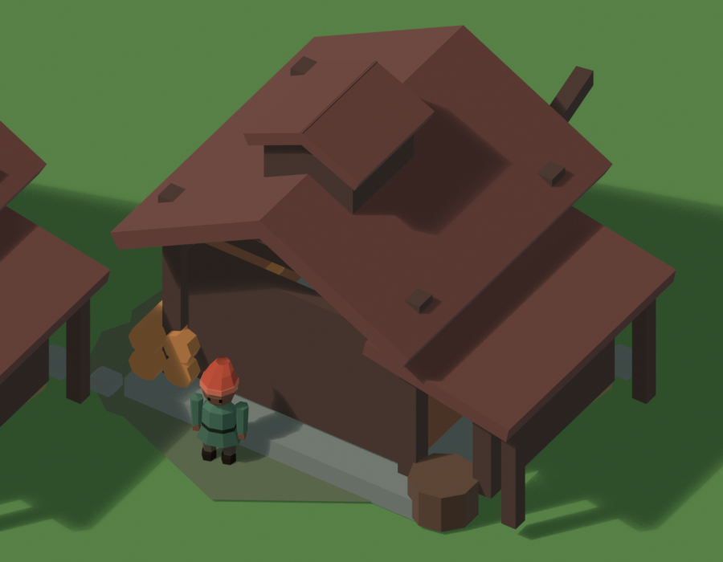
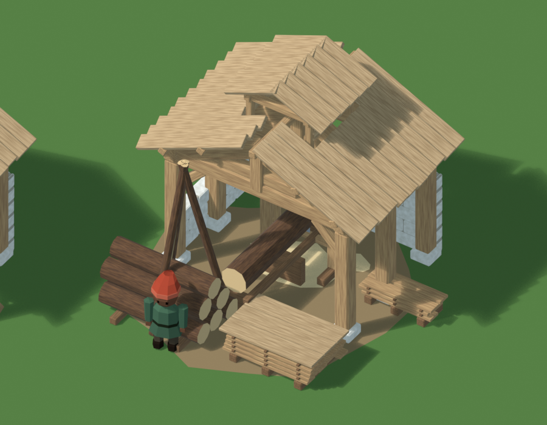
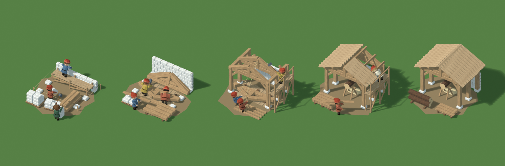

# Scierie au langage de la factory : maquette d'étude (28 octobre 2026)

Statut : **proposition, à valider par Tristan**, chantier compris. Aucun code du jeu n'est modifié.

La scierie actuelle (`sawmill-factory.ts`) est le dernier atelier encore construit à l'ancienne : des boîtes et des cylindres aux couleurs unies. Cette maquette la redessine avec le vocabulaire des bâtiments de la factory.

## Ce qui est repris de la factory

| Élément | Source dans le code | Dans la maquette |
| --- | --- | --- |
| Charpente à fermes à poinçon : entrait, arbalétriers, poinçon, contrefiches | `timber-thatch.ts`, section 0,123 × 0,153 | Trois fermes, dont les deux pignons |
| Pièces équarries chanfreinées | `compactTimberBeamGeometry`, chanfrein de 10 % | Poteaux, sablières, aisseliers, pannes |
| Toit en planches sur pannes | `TimberThatch`, planches de 0,038 | Planches dans le sens de la pente, bords décalés |
| Pente de 25° et pignon ouvert | tailleur de pierres (`stonemason-factory.ts`) | Atelier ouvert côté cour |
| Maçonnerie calcaire, module 0,28 × 0,14 × 0,14, assises décalées, arêtes adoucies, mortier en retrait | `building-plan.ts`, `stoneBlockGeometry` | Mur du fond à tous les niveaux, muret latéral dès le niveau 2, dés de pierre sous les poteaux |
| Chêne clair veiné, bouts de rondins clairs | matériaux `hall-oak` et `hall-roof-boards` | Teintes et fibres approchées |

## Niveaux

La scierie reste sur **une case de 2,5 m**, comme aujourd'hui. Les niveaux enrichissent l'atelier sans agrandir son emprise ; l'ancienne scierie débordait de la case au niveau 2 avec son appentis.

| Niveau | Atelier | Poste de sciage | Cour | Triangles |
| --- | --- | --- | --- | ---: |
| 1 | Halle en bois sur dés de pierre, mur du fond en calcaire | Scie de long : grume sur deux chevalets, lame dans le trait | 3 grumes, petite pile de planches | 1 848 |
| 2 | Muret latéral en calcaire | Scie à cadre : bâti, châssis à trois lames, chariot sur rails ; grume entière avant les lames, planches débitées après | 5 grumes sur traverses, pile de séchage à lattes, couverte | 2 374 |
| 3 | Lanterne d'aération à persiennes sur le faîtage | Idem | Chèvre de levage à trois perches au-dessus des grumes, seconde pile de planches | 3 122 |

L'ancienne scierie fait environ 1 100 triangles à chaque niveau. Les nouveaux comptes incluent les chanfreins, sans niveau de détail (LOD) ; les LOD 1 et 2 de la factory les réduisent comme pour les autres bâtiments.

## Aperçus

| | Actuelle | Proposition |
| --- | --- | --- |
| Niveaux 1, 2 et 3 |  |  |
| Niveau 3, de près |  |  |

Zoom moyen du jeu, un villageois faisant 17 px, avec le niveau 2 de chaque version : [previews/zoom-moyen.png](previews/zoom-moyen.png).

- **Au zoom moyen**, l'atelier ouvert se lit comme une construction de la factory : toit clair en planches, pierre claire. Le poste de sciage et les piles sont visibles depuis la cour.
- **La progression se voit sans agrandir l'emprise** : muret latéral, scie de long puis scie à cadre, lanterne et chèvre au niveau 3.

## Chantier : étapes de travaux et bâtisseurs

**Proposé, à valider.** La spec actuelle (`SPEC-FACTORY-BATIMENTS.md`, « Représentations intermédiaires de travaux ») prévoit une liste ordonnée d'étapes visuelles par transition, avec **une seule étape `travaux`** pour l'instant. Elle laisse hors de la première tranche la progression temporelle du maillage, les ouvriers animés et les livraisons. Cette maquette propose d'étendre cette liste à quatre étapes pour la construction initiale de la scierie, et d'y animer des bâtisseurs.

| Étape | Ce qui est construit | Ce qui attend sur le chantier | Bâtisseurs |
| --- | --- | --- | --- |
| 1. Implantation et maçonnerie | Piquets et cordeaux, dés de pierre, mur du fond sur 3 assises et demie | Échafaudage contre le mur, deux palettes de pierres taillées, banc de taille, poteaux livrés | Maçon sur l'échafaudage, porteur, tailleur à la masse |
| 2. Assemblage au sol | Mur achevé, plancher provisoire en planches | Une ferme assemblée à plat sur des cales, deux fermes en attente appuyées contre le mur, poteaux couchés | Charpentier au maillet, aide, porteur de planche |
| 3. Levage | Poteaux, aisseliers, sablières, deux fermes levées | Dernière ferme à plat, pannes couchées, échafaudage le long du versant | Deux haleurs au cordage, charpentier sur l'échafaudage |
| 4. Couverture | Pannes, un versant couvert et l'autre à moitié, poste de sciage installé | Échafaudage, pile de planches | Couvreur sur l'échafaudage, porteur de planche |

Vues de près : [étape 1](previews/chantier-etape-1.png), [étape 2](previews/chantier-etape-2.png), [étape 3](previews/chantier-etape-3.png), [étape 4](previews/chantier-etape-4.png).

**Séquence animée** de l'étape 1 sur 8 s : [previews/chantier-maconnerie.mp4](previews/chantier-maconnerie.mp4).
- Le maçon prend une pierre sur le platelage, se retourne et la pose dans l'assise : trois pierres apparaissent dans le mur.
- Le porteur charge à la palette, monte la pierre au pied de l'échafaudage, la passe au maçon et repart.
- Le tailleur frappe au banc, avec des éclats à chaque coup.

Les gestes viennent du planificateur des chantiers d'exploitation (`poses.py`, puis `worker-gestures.ts` dans le jeu) : frappes de masse, poses clés, marche chargée.

**Ce que l'intégration demanderait** (proposé) :
1. **Étape affichée** : déduite de la fenêtre de travaux du serveur, début et fin du chantier, comme les touffes du jardin. Avec quatre étapes de durées égales, l'étape k s'affiche à partir de k/4 de la fenêtre. Un rechargement retombe sur la même étape. L'achèvement reste confirmé par le serveur, pas par l'horloge du client.
2. **Bâtisseurs** : des représentants visuels, comme ceux des chantiers d'exploitation, sans crédit ni ressource déclenchés par un geste. Leurs gestes sont tirés par graine et calés sur l'heure du serveur, donc identiques pour tous les joueurs.
3. **Éléments de chantier** : échafaudages, palettes, fermes en attente et plancher provisoire sont décoratifs. Ils restent dans la case et laissent libre l'entrée de la cour, comme le demande la spec.
4. **Amélioration 1 → 2** : muret latéral et scie à cadre, avec ses propres étapes. Elle n'est pas dessinée ici.

## Points ouverts

1. **Lanterne du niveau 3** : vue sous la caméra du jeu, elle peut se lire comme un trou dans le toit. Une alternative est d'agrandir la lanterne, ou de marquer le niveau 3 autrement, par un auvent sur la cour.
2. **Chantier de l'amélioration 1 → 2** : pas encore dessiné (la construction initiale l'est, voir plus haut).
3. **Animation** : la scie à cadre et le chariot pourraient s'animer quand la scierie produit. C'est hors de cette étude.

## Pour l'intégration

Il ne s'agit pas d'importer le maillage Blender. La maquette sert à valider l'apparence, puis on écrit une recette de la factory, `sawmill-factory.ts` réécrit sur le modèle de `stonemason-factory.ts`, avec :
- `TimberThatch.buildRoof()` pour la charpente et la couverture ;
- `stoneBlockGeometry` pour la maçonnerie ;
- `compactTimberBeamGeometry` pour les pièces équarries ;
- les rondins de la factory.

On garde ainsi les matériaux partagés, les palettes, les LOD, l'état de travaux, la compilation par `factory:bake` et les miniatures. L'emprise d'une case et les capacités économiques ne changent pas.

## Fichiers

- `sources/chantier.py` : étapes de chantier, bâtisseurs, séquence animée, `chantier.blend`. À lancer comme `scierie.py` ; `-- --sans-video` saute la vidéo.
- `sources/scierie.py` : construit la scierie proposée et l'ancienne, portée depuis `sawmill-factory.ts`, puis les rendus et `scierie.blend`. À lancer sans interface :
  `blender --background --factory-startup --python blender-elements/scierie/sources/scierie.py`
- `scierie.blend` : scènes `SCIERIE actuelle`, `SCIERIE factory` et `SCIERIE zoom moyen`.
- `previews/` : rendus EEVEE sous la caméra du jeu.
