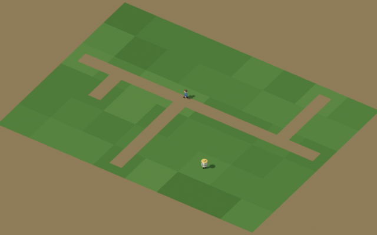
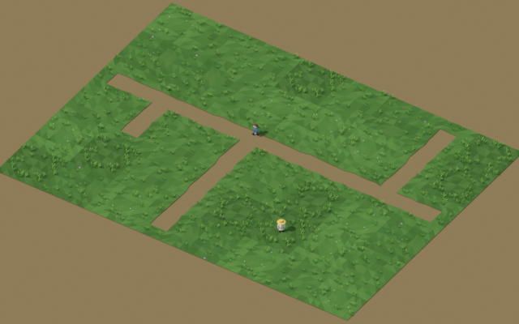
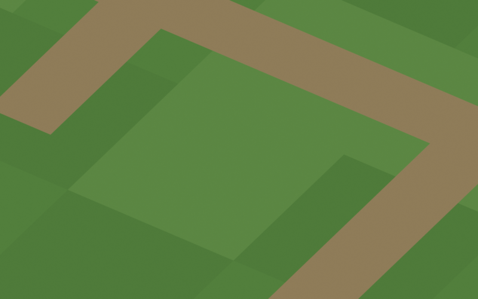
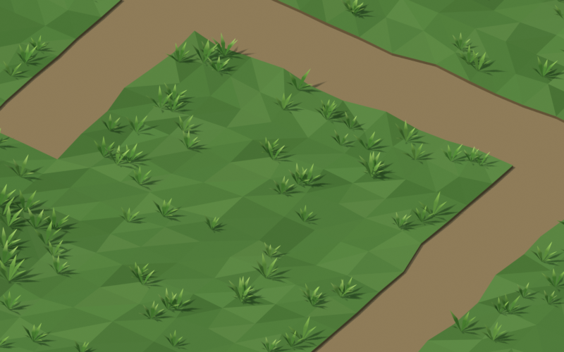

# Sol en gazon et chemins de terre : étude (26 octobre 2026)

Statut : **prototype d'étude**. Aucun code du jeu n'est modifié.

## Principe

- Le sol actuel devient de la **terre battue**, avec les hauteurs, murets et eau qu'il a déjà.
- Un **tapis de gazon** de 3,5 cm d'épaisseur est posé par-dessus, une tuile par case de 2,5 m, en *thin instances*.
- **Un chemin de terre est une absence de gazon** : il n'est pas dessiné, la terre apparaît dans le trou.

## Pièces

**4 tuiles de gazon**, à tourner par quarts de tour, soit 16 aspects :

| Tuile | Contenu | Triangles |
| --- | --- | ---: |
| `herbe-ras` | 16 touffes | 332 |
| `herbe-dru` | 30 touffes, plus hautes | 480 |
| `herbe-fleuri` | 16 touffes, 6 fleurs | 338 |
| `herbe-trefle` | 12 touffes, trèfle en taches, 2 cailloux | 262 |

- **Touffes à la manière des fanes du carré potager** : 5 à 7 feuilles en losange (2 triangles chacune) qui rayonnent, pied sombre et pointe claire. Elles sont plus fines, plus droites et plus jaunes que des fanes, pour ne pas confondre une prairie avec un jardin.
- Une première version en petits brins, trop discrète, est mesurée dans la passe 1.

- **Dalle** : une grille facettée de 6 × 6 dont seul l'intérieur est irrégulier. Les sommets du bord de case sont fixes, si bien qu'une tuile se raccorde à toutes ses voisines, dans toutes les rotations.
- **Jupe** : une bande plus sombre descend jusqu'à la terre le long des chemins et en bord de case, pour les falaises.

**6 découpes de chemin**, d'après `roadTileRects` : point, bout, droit, angle, T et croix, de 290 à 320 triangles.
- Le chemin fait 0,94 m de large (`ROAD_HALF_WIDTH` = 0,47 m).
- Son bord est irrégulier à l'intérieur de la case, mais tombe exactement à ±0,47 m sur le bord de case, pour continuer chez la voisine.
- Les 16 combinaisons de voisins se ramènent à ces 6 formes tournées.

## Aperçus

Le sol actuel est reproduit à gauche, le gazon à droite.

| | Actuel | Gazon |
| --- | --- | --- |
| Zoom moyen (villageois de 17 px) |  |  |
| Zoom rapproché |  |  |

Planche des pièces : [previews/planche-pieces.png](previews/planche-pieces.png).

- **Au zoom moyen**, le gazon donne un grain fin et casse le damier des cases ; les chemins sont plus nets.
- **Au zoom rapproché**, on voit les touffes, les fleurs, le bord irrégulier des chemins et la petite marche de terre.

## Coût mesuré

Banc [apps/world-web/bench/herbe.html](../../apps/world-web/bench/herbe.html), sur une MX230. Résultats complets : [passe 2, touffes en fanes](../../apps/world-web/bench/resultats/herbe-passe-2-mx230.json) ; [passe 1, petits brins](../../apps/world-web/bench/resultats/herbe-passe-1-mx230.json).

Le banc compare deux modes sur un terrain de n × n cases, traversé d'un chemin de terre toutes les 6 cases :
- **plat** : sol actuel, dalle plate et chemin creusé ;
- **gazon** : terre plate et tapis en *thin instances*.

« Complet » mesure une image rendue puis lue sur le GPU, en médiane. Elle n'est donc pas plafonnée à 60 i/s.

Passe 2, touffes en fanes :

| Cases | Triangles (plat → gazon) | GPU, ms (plat → gazon) | Complet, ms (plat → gazon) | Images |
| ---: | --- | --- | --- | --- |
| 20 × 20 | 2,6 k → 135 k | 1,3 → 1,9 | 3,9 → 5,6 | 60 i/s dans les deux modes |
| 40 × 40 | 11 k → 542 k | 1,9 → 3,5 | 6,4 → 8,6 | 60 i/s dans les deux modes |
| 80 × 80 | 43 k → 2,2 M | 2,0 → 9,0 | 5,6 → 14,7 | 60 i/s dans les deux modes |

Vue entière du terrain. Les appels de dessin restent de 10 à 32.

**À retenir**
- Le jeu reste à 60 i/s dans toutes les configurations.
- Jusqu'à 1 600 cases dessinées, le gazon coûte environ 2 ms par image.
- À 6 400 cases (2,2 millions de triangles), il ajoute environ 9 ms : une image tient encore dans les 16,7 ms, mais avec peu de marge.
- **Pas de tri par champ de vision dans ce banc** : chaque pièce y forme un seul maillage pour tout le terrain. Au zoom moyen, les 6 400 cases sont donc dessinées alors qu'une soixantaine seulement sont à l'écran.

## Pour une intégration

1. **Regrouper les *thin instances* par unité de rendu du terrain** (16 × 16 cases, `terrain-unit.ts`). Le champ de vision écarte alors les unités hors écran, et au zoom moyen on ne dessinerait que quelques unités.
2. **Niveau de détail** : au-delà du zoom moyen, tuiles sans touffes, ou sol plat actuel teinté. Les touffes font les trois quarts des triangles d'une tuile.
3. **Construction** : réutiliser le découpage des routes déjà fait une fois par changement dans `terrain-renderer.ts`, sans nouveau calcul par requête de terrain. C'est une zone partagée : prévenir l'autre session avant d'y toucher.
4. **Exclusions** : eau, emprises de bâtiments, jardins et voirie pavée. La route charretière reste posée sur la terre.
5. Mesurer à nouveau dans le jeu, sur un gros village (Catmark).

## Fichiers

- `sources/tuiles_herbe.py` : génère les pièces, les scènes de démonstration, les rendus, `sol-herbe.blend` et `apps/world-web/bench/assets/tuiles-herbe.json`. À lancer sans interface :
  `blender --background --factory-startup --python blender-elements/sol-herbe/sources/tuiles_herbe.py`
- `sol-herbe.blend` : scènes `SOL actuel`, `SOL herbe` et `SOL planche`.
- `previews/` : rendus EEVEE sous la caméra du jeu.
