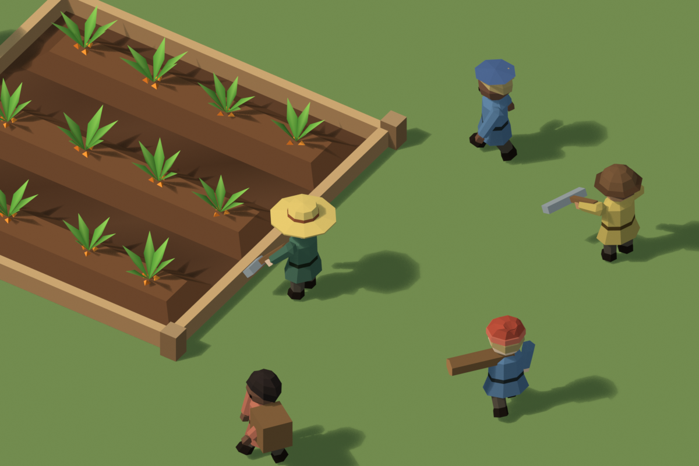
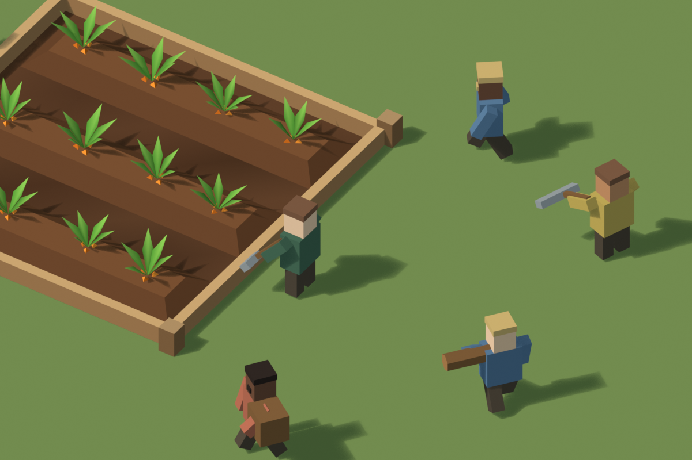
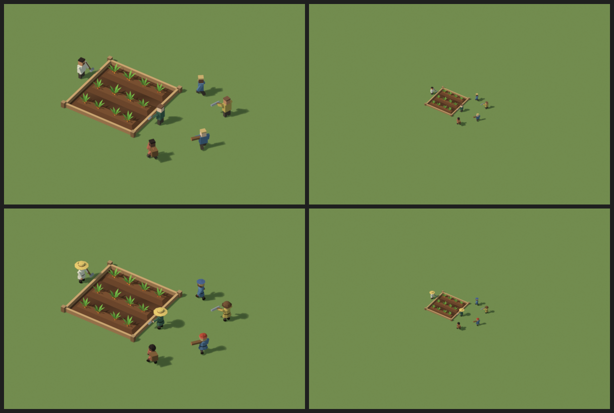
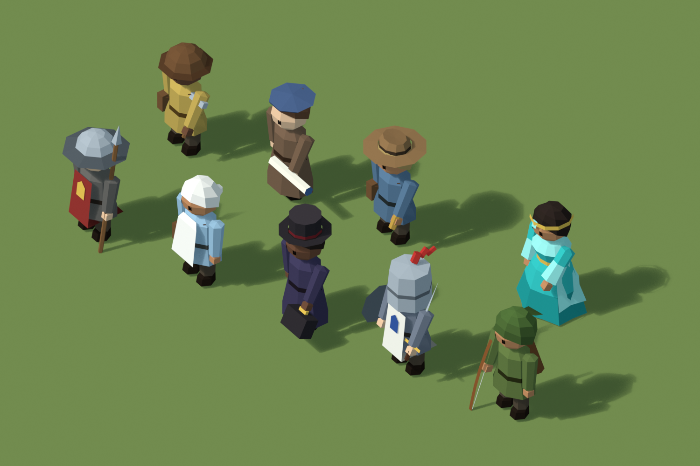

# Villageois « figurines » — proposition (Opus 5.5, 25 octobre 2026)

Proposition d'un nouveau rendu des villageois, dans la même veine que le carré potager : figurines en bois peint, facettées, une seule teinte par pièce. Ce n'est pas encore un kit d'intégration. Aucun code du jeu n'est modifié.

## Le point de départ

`worker-figure.ts` construit chaque villageois avec 8 pavés : corps, tête, cheveux, visage, deux bras, deux jambes. `village-workers.ts` y ajoute l'outil (2 pavés) et la charge (panier ou bûche).

Chaque pavé est un **clone** de `worker-box-geometry`, pas une instance : **jusqu'à 11 maillages, donc 11 appels de dessin, par villageois affiché**. C'est le poste le plus coûteux pour un GPU déjà limitant sur les gros villages. Avec 96 triangles, la géométrie, elle, est négligeable.

Vue de la caméra du jeu, on voit surtout le dessus des têtes et les épaules. Aujourd'hui, le métier ne se lit qu'à l'outil, quand il est sorti.

*La même scène avec les villageois actuels, reproduits à l'identique (dimensions et articulations de `buildWorkerFigure`).*

## La figurine

- **Silhouette** :
  - tunique octogonale évasée avec ceinture sombre ;
  - tête facettée un peu plus grosse (diamètre 0,22 m contre un cube de 0,15 m), avec deux yeux ;
  - mains distinctes et chaussures sombres.
- **Même squelette que l'actuel** : épaules à ±0,15 m et 0,462 m du sol, hanches à ±0,065 m et 0,23 m, outil sur le bras droit. Les rotations de `village-workers.ts` (marche, port, coups de pioche, jardinage) s'appliquent sans changement : les poses des aperçus sont calculées avec les mêmes formules.
- **Le métier se lit d'en haut, au couvre-chef** : chapeau de paille (jardin), bonnet de laine (bois), casque de cuir (pierre, nivellement), béret (relevés, commerce). Le villageois au repos est en cheveux, coupe courte, chignon ou longue.
- **Couleurs** : la palette `WORKER_COLOURS` est conservée. La teinte de chaque villageois s'applique par pièce ; les reliefs (ceinture, ourlet, chaussures, yeux) sont des multiplicateurs inscrits dans les sommets.

*En haut l'actuel, en bas la proposition. À gauche le zoom minimal, à droite le zoom moyen, où un villageois fait environ 17 px.* Au zoom minimal, chapeaux et silhouettes se distinguent nettement. Au zoom moyen, les deux versions ne sont plus que des points ; il n'y reste qu'une tache de couleur pour le couvre-chef. Le gain visuel est donc proche et moyen, pas lointain.

## Tenues des spécialisations et Oracle

Pour les spécialisations à venir, une spécialisation = **tenue + couvre-chef + objets**, tous choisis dans un kit commun.

*Au premier rang, de gauche à droite : garde, infirmier, médecin, chevalier, archer. Au second rang : géologue, architecte, géographe, puis l'Oracle à droite.*

| Spécialisation | Tenue | Couvre-chef | Objets | Triangles |
| --- | --- | --- | --- | ---: |
| Garde | tunique + tabard rouge à écusson | chapeau de fer | lance | 519 |
| Infirmier | tunique + tablier blanc | coiffe nouée | sacoche | 448 |
| Médecin | manteau long | haut-de-forme | sacoche de médecin | 544 |
| Chevalier | tunique + cotte blanche à écusson bleu | heaume à plumet | épée, bouclier | 539 |
| Archer | tunique verte | capuche | arc, carquois | 539 |
| Géologue | tunique | casque de cuir | marteau, sacoche | 524 |
| Architecte | manteau long | béret | rouleau de plans | 492 |
| Géographe | tunique | chapeau de feutre | longue-vue, sacoche | 574 |
| **Oracle** | robe turquoise à plis, ceinture d'or, voile clair ouvert devant | diadème à pierre turquoise | manches amples | 450 |

**L'Oracle** a sa propre silhouette :
- hanches et poitrine plus marquées, taille ceinturée ;
- robe longue jusqu'au sol, plis plus amples vers l'ourlet ;
- voile turquoise clair par-dessus, avec des manches évasées.

Pour la légèreté du tissu, je propose les plis et le voile plutôt qu'une transparence : le rendu reste opaque, et le tri de transparence coûterait cher.

**L'infirmier ne porte volontairement pas de croix rouge.** L'emblème est protégé par les Conventions de Genève et son usage dans les jeux est déconseillé par la Croix-Rouge. Une autre marque (feuille, croix verte) est possible si besoin.

**Le chevalier sur sa licorne** est un asset à part : un quadrupède avec sa propre animation de marche. Il n'est pas commencé.

## Coût et intégration envisagée

| | Actuel | Figurine |
| --- | ---: | ---: |
| Triangles par villageois (sans outil ni charge) | 96 | 364 + coiffure 24 à 110 |
| Maillages par villageois | 8 à 11 clones | 0 (*thin instances*) |
| Appels de dessin pour tout le village | ~10 × villageois visibles | ~1 par type de pièce |

Chaque type de pièce (tunique, manteau, tête, bras, main, jambe, chaque coiffure, chaque couvre-chef, chaque objet) devient **un** maillage en *thin instances* pour tout le village, avec une teinte par instance. Les bras et les mains partagent la matrice de leur bras ; la tête, les cheveux et le chapeau partagent celle de la tête. Le calcul des matrices reste celui des `TransformNode` actuels.

Avec le kit des spécialisations, on reste autour de 40 appels de dessin pour toute la population, quel que soit son nombre. La figurine coûte environ 4 à 5 fois plus de triangles, mais 100 villageois visibles ne font que ~50 000 triangles. C'est l'échange inverse de celui dont souffre aujourd'hui le GPU.

**À vérifier à l'intégration** :
- **La teinte par instance** : il faut confirmer dans Babylon que le multiplicateur de sommets et la couleur de *thin instance* se combinent bien avec le matériau du jeu.
- **La sélection** : elle passe aujourd'hui par `metadata` sur les maillages du corps et de la tête (`representativeId`). Avec des *thin instances*, il faut `thinInstanceEnablePicking` et une table d'indice d'instance vers villageois.
- **Les mesures** : rien n'est mesuré sur MX230 ni sur Catmark.

## Prototype des chantiers animés (25 octobre 2026)

Prototype des gestes et des séquences de [SPEC-CHANTIERS-ANIMES-SEQUENCES.md](../../docs/SPEC-CHANTIERS-ANIMES-SEQUENCES.md), avec les figurines et un pivot de taille (le buste pivote à 0,25 m du sol, jambes fixes).

**Contenu**
- Scène `VIL chantiers` : 8 s à 24 i/s, trois chantiers qui travaillent en parallèle, chaque villageois à son propre rythme.
  - **Bois** : abatteur à la hache et arbre accessoire qui tombe après trois coups, binôme de scie sur tronc couché (un tronçon tombe, pause, reprise plus loin), fendeur au billot, porteur qui empile.
  - **Pierre** : deux piocheurs au front (éclats, poussière, blocs détachés), casseur à la masse dont le bloc rétrécit, manutentionnaire au panier.
  - **Jardin** : le jardinier arrache trois touffes au moment exact de leur disparition, carotte en main, panier qui se remplit.
- Scène `VIL planche poses` : les poses clés figées.

**Vidéos et images**
- [chantiers/zoom-moyen-17px.mp4](previews/chantiers/zoom-moyen-17px.mp4) : vue d'ensemble, villageois à 17 px.
- Gros plans : [bois](previews/chantiers/bois-proche.mp4), [pierre](previews/chantiers/pierre-proche.mp4), [jardin](previews/chantiers/jardin-proche.mp4).
- Deux images à 17 px agrandies ×3 sans lissage, à 2,4 s et 6,0 s ; la planche de poses [proche](poses/planche-poses-proche.png) et [à 17 px](poses/planche-poses-17px.png).

**Poses exportées** : [poses/poses.json](poses/poses.json). On y trouve les angles de repos, de préparation et d'impact par geste, la scie, les poses de transport, de ramassage, d'arrachage et de pause, le découpage d'un coup et les pivots.

Signes : bras et jambes négatifs vers l'avant, **buste positif penché en avant**. La spécification a été corrigée en conséquence : elle donnait le buste avec le signe inverse.

**Lisibilité à 17 px**
- **Se lit** : l'arbre debout puis couché, la hache levée au-dessus de la tête, la pioche armée, le chapeau de paille penché sur le rang, le tronc sur chevalets.
- **Se lit mal**, à reprendre avant l'intégration :
  - le sciage : la lame de 1,5 cm disparaît, et on ne voit que deux figures face à face. Il faudrait une scie plus épaisse et plus claire, et un balancement du buste plus ample ;
  - le casseur et le manutentionnaire, trop proches dans ce montage.
- Les copeaux et les éclats ne se voient qu'au zoom rapproché, comme prévu par la spécification.

**Limites du prototype** : séquences écrites à la main sur 8 s, pas le planificateur par blocs de 30 s de la spécification ; pas de mesure de performance.

## Fichiers

- `sources/build_villageois.py` : reproduction de la figure actuelle, figurine, coiffures, couvre-chefs de base, scènes de comparaison. `build(garden_ns)` renvoie les comptes de triangles.
- `sources/tenues.py` : tenues, couvre-chefs et objets des spécialisations, Oracle, scène `VIL specialites`.
- `sources/poses.py` : pivot de taille, gestes, mini-planificateur, effets, trois chantiers animés, planche de poses, export JSON.
- `sources/villageois.blend` : scènes `VIL actuel`, `VIL proposition`, `VIL specialites`, `VIL chantiers` (animée) et `VIL planche poses`.
- `previews/` : rendus EEVEE éclairés par un soleil, sous la caméra des aperçus jardins.

Pour régénérer, exécuter dans Blender, dans un même espace de noms :
1. `../contre-proposition-opus/sources/build_opus.py` (la parcelle du décor) ;
2. `build_villageois.py` et `build(...)` ;
3. `tenues.py` et `build_lineup(...)`.
